# DefinITely, the most boring learning content you will ever see!

C: Jan Bielecki, PyCon Wrocław 2026

## Intro

### More Philosophy than Python

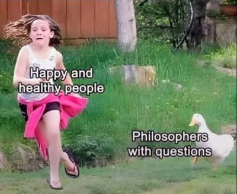

### Learning platform based on DefinIT project

C: k4liber.github.io/definit-dsa

Notes:

DefinIT learning platform is a web application that allows users to learn specific topic in a very structured way. The learning platform is only one of the possible use cases of the DefinIT project. The main goal of the DefinIT project is to create a standardized and unambiguous terminology, which can be used in various applications, including learning platforms.

### Learning platform based on DefinIT project

C: "Perfection is achieved, not when there is nothing more to add, but when there is nothing left to take away." ~ Antoine de Saint-Exupéry

### Demo

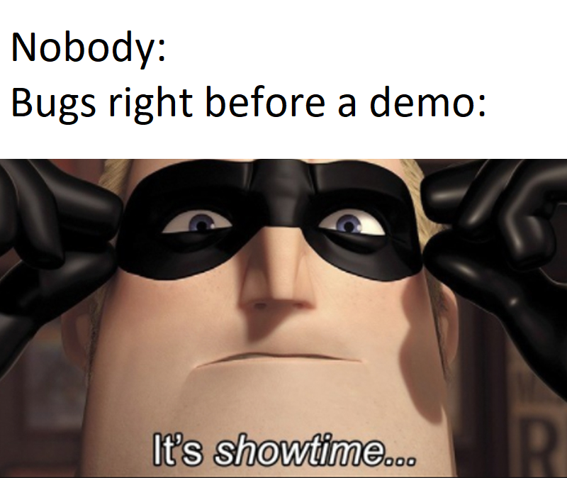

C: Showcase of http://k4liber.github.io/definit-dsa

## About me

### Jan Bielecki (1994 - ?)

C: Senior Full Stack Developer at Ørsted (2023 - ?)

### Jan Bielecki (1994 - ?)

C: "Any sufficiently advanced technology is indistinguishable from magic." ~ Arthur C. Clarke

Notes:

Technology/Engineering is kind of a hacking of the universe, a way to understand and manipulate the world around us.

### Jan Bielecki (1994 - ?)

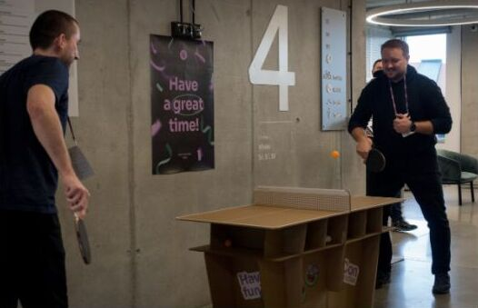

C: Running, Calistenics, Ping-pong, Foosball, Trekking, Snowboarding

## About Ørsted

### Hans Christian Ørsted (1777 - 1851)

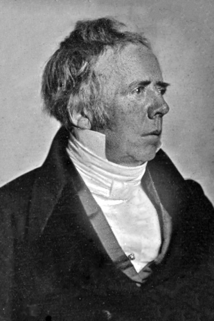

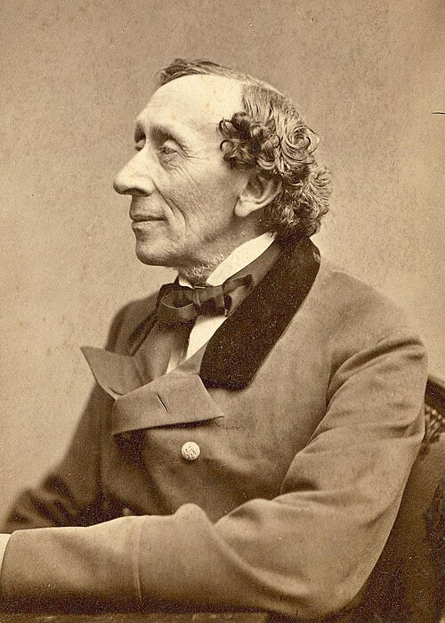

C: Close friend of a Hans Christian Andersen (1805 - 1875), author of many fairy tales, including "The Little Mermaid" and "The Ugly Duckling")

### Hans Christian Ørsted (1777 - 1851)

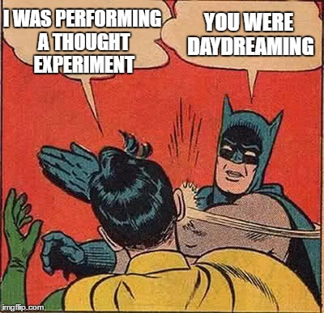

C: First to explicitly describe and name the "thought experiment"

### Hans Christian Ørsted (1777 - 1851)

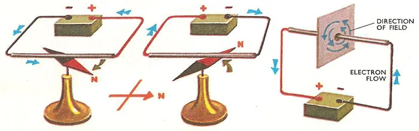

C: In 1820, Ørsted published his discovery that a compass needle was deflected from magnetic north by a nearby electric current, confirming a direct relationship between electricity and magnetism.

Ref: https://subratachak.wordpress.com/2017/12/16/oerstead/

## DefinIT philosophy

### Definitions as "patterns in the universe"

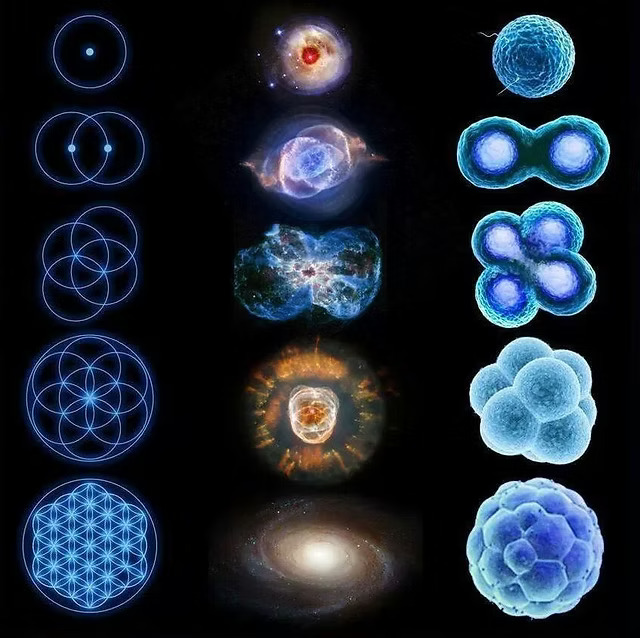

C: Patterns in math, astronomy, biology.

### Definitions as "patterns in the universe"

C: A software design pattern.

Ref: https://thecodinggopher.substack.com/p/the-adapter-design-pattern

### The theory of acyclic references in terminology

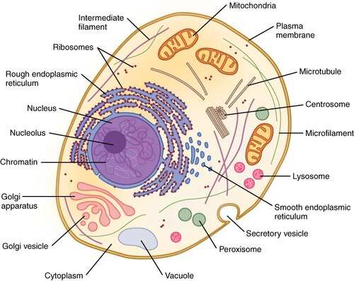

C: The exercise is to describe mitochondria without referring to the cell.

N: Set of definitions is called terminology. A terminology is acyclic if it does not contain any circular references between definitions.

### Naming is irrelevant

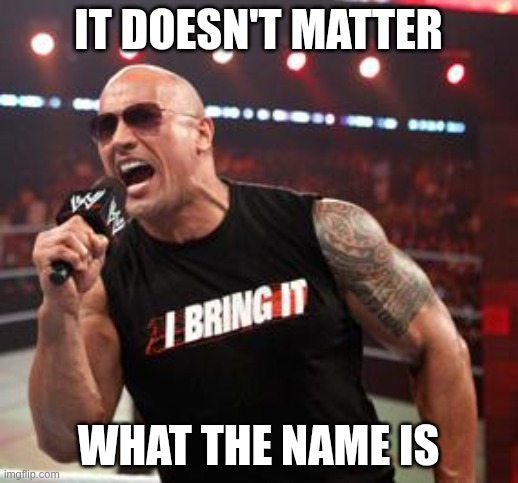

C: Naming does not matter, or at least is a secondary concern.

N: The naming is a seperate exercise. It seems like we can put a boundary between the naming and the definition. This point of view is shared by Eugen Wüster, terminologist, regarded as "the father of technological standardization".

### Languages are ambiguous

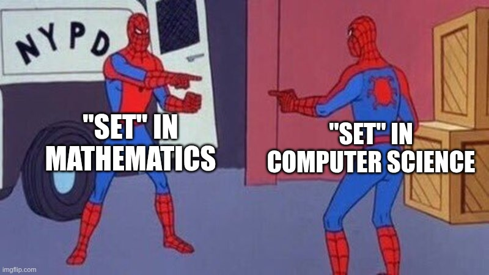

C: Even single words can have different meanings.

### An experiment to "prove the theory"

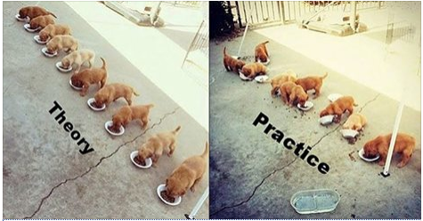

C: "In theory, there is no difference between theory and practice. But in practice, there is." ~ Benjamin Brewster

N: Just an intro. The full description will be presented in the section "Data Structures and Algorithms course".

## Literature review

### Standardized glossary in computing

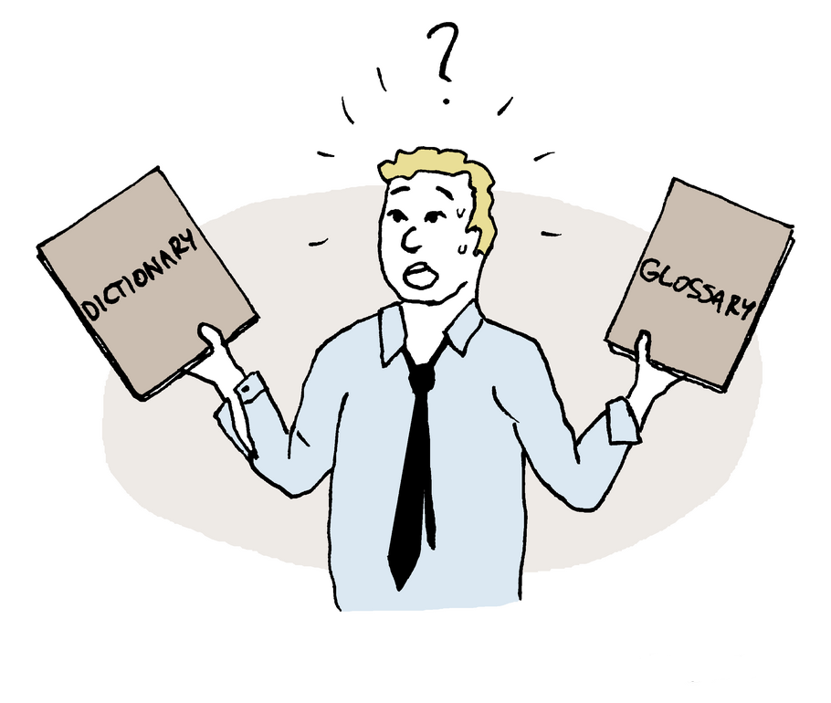

C: A glossary is a focused collection of SPECIALIZED terms and DEFINITIONS tied to a SPECIFIC SUBJECT, book, or document.

Ref: https://dataedo.com/cartoon/glossary-or-dictionary

### Thomas Edison (1847 - 1931)

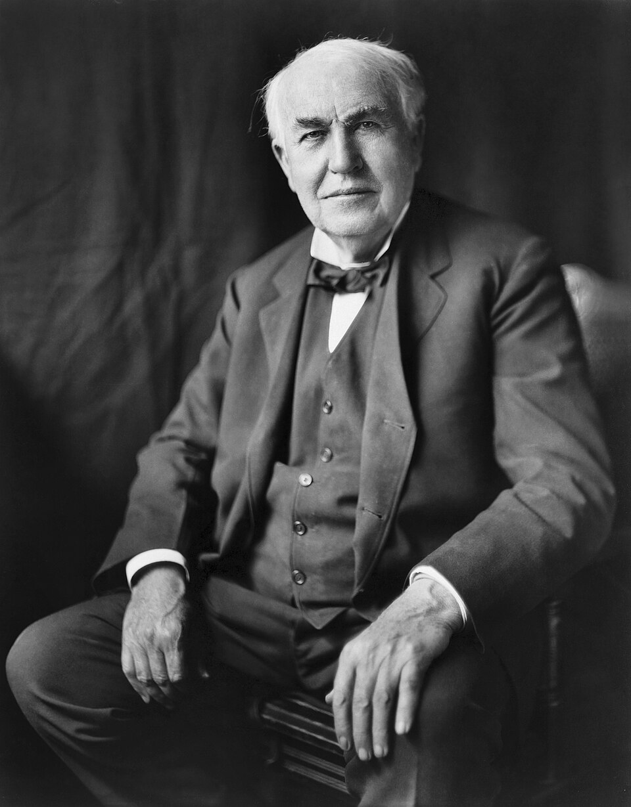

C: "Bugs" - little faults and difficulties

### Grace Hopper (1906 - 1992)

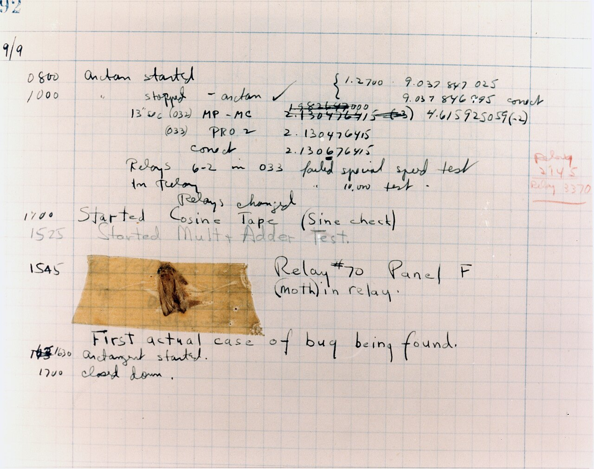

C: "First actual case of bug being found"

N: A popular story from the 1940s is from Admiral Grace Hopper. While she was working on a Mark II computer at Harvard University, her associates discovered a moth stuck in a relay that impeded operation and wrote in a log book "First actual case of a bug being found". Although probably a joke, conflating the two meanings of bug (biological and defect), the story indicates that the term was used in the computer field at that time. She popularized the term debugging to mean fixing a computer program. Similarly, the term debugging was used in aeronautics before entering the world of computers. A letter from J. Robert Oppenheimer, director of the WWII atomic bomb Manhattan Project at Los Alamos, used the term in a letter to Dr. Ernest Lawrence at UC Berkeley, dated October 27, 1944,[2] regarding the recruitment of additional technical staff. The Oxford English Dictionary entry for debug uses the term debugging in reference to airplane engine testing in a 1945 article in the Journal of the Royal Aeronautical Society. An article in "Airforce" (June 1945 p. 50) refers to debugging aircraft cameras.

### Grace Hopper (1906 - 1992)

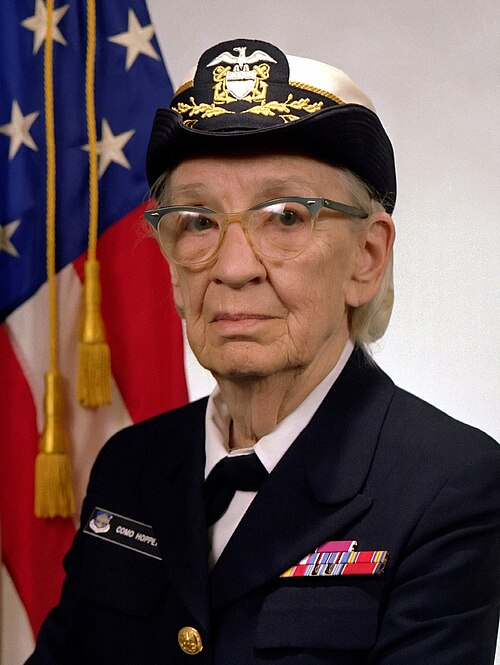

C: "First Glossary of Programming Terminology"

### Eugen Wüster (1898 - 1977)

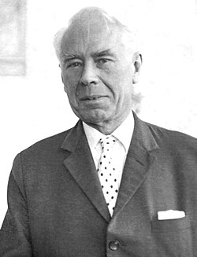

C: Eugen Wüster is often recognized as the founder of terminology.

N: To eliminate ambiguity from technical languages by means of standardisation of terminology in order to make them efficient tools of communication.

### Eugen Wüster (1898 - 1977)

C: Concepts (or definitions) exist even before they are named - thus naming and it relevance for the terminology field have been neglected."

### Ludwik Zamenhof (1859 - 1917)

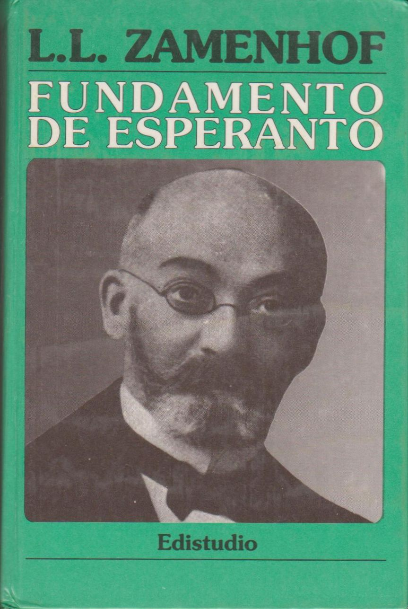

C: Wüster was a staunch advocate of a single language for scientific and technical communication.

### Philosophy of definitions

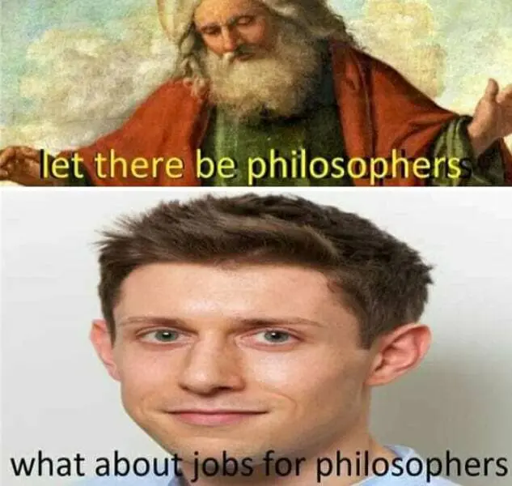

### Bertrand Russell (1872 - 1970)

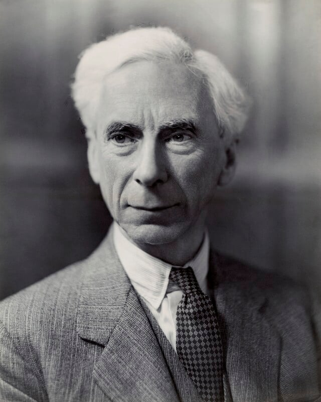

C: In 1950, Russell was awarded the Nobel Prize in Literature "in recognition of his varied and significant writings in which he champions humanitarian ideals and freedom of thought".

### Logical atomism

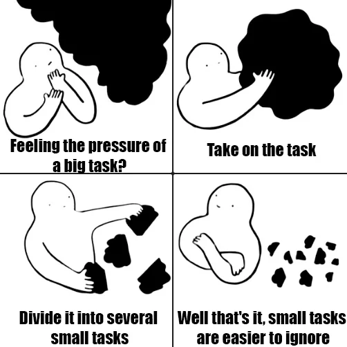

C: The world is composed of independent, irreducible units of reality (logical atoms).

N: Logical atomism is an early 20th-century philosophical view that the world is composed of independent, irreducible units of reality (logical atoms), and that language mirrors this structure.

### Benoit Mandelbrot (1924 - 2010)

C: Mandelbrot Set, being indisputably complex, uses a simple recursive equation:

C: $z_{n+1} = z_n^2 + c$, starting with $z_0 = 0$

### John Conway (1937 - 2020)

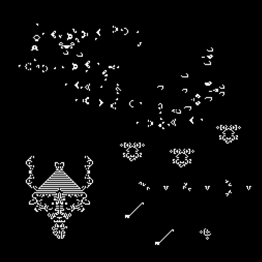

C: Conway's Game of Life

### Mark Changizi (1969 - ?)

C: Organized hierarchies in Dictionaries

Ref: https://www.sciencedirect.com/science/article/abs/pii/S1389041708000120

## Data Structures and Algorithms course

### How it was created

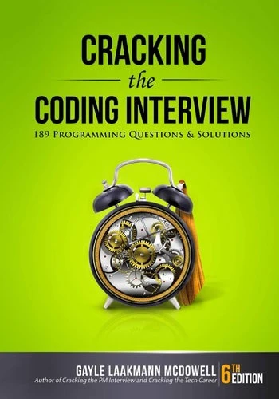

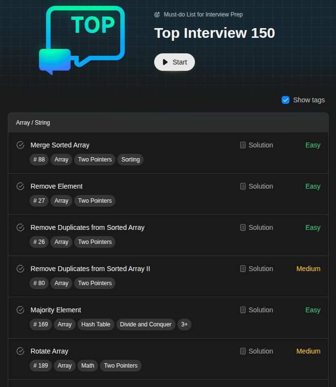

C: Transform the content of a book or a course into DefinIT format.

### DefinIT format

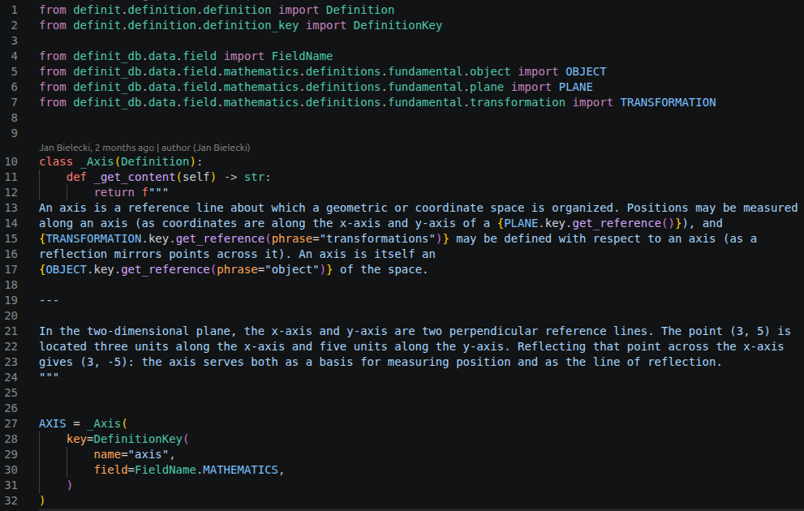

C: Definition as a Python module.

### DSA course statistics

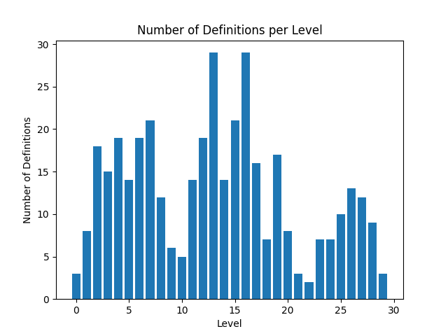

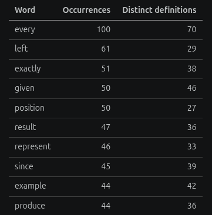

C: 30 levels, 380 definitions, ~1700 unique non-definition words and 1783 references.

### Issues

## Further work

### [MUST HAVE] Write a paper

### [NICE TO HAVE] Create the next course

N: Mind the "abstraction level" of the course, it should be just above the level of DSA course, so it can reuse the same definitions.

### [NICE TO HAVE] Other applications

C: Food for LLMs - maybe finetuning?

N: The definitions are suppose to have a high quality.

### [NICE TO HAVE] Other applications

C: New kind of science -> reducing the number of books/articles

## Please generate a thank you slide for the audience. Don't make a mistake.
